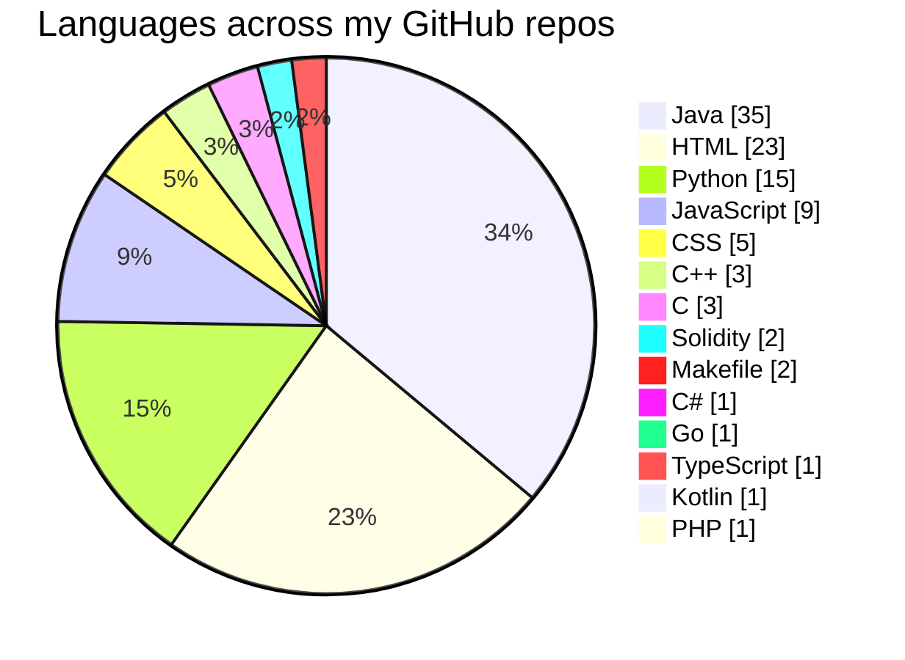

<p align="center">

</p>

<p align="center">
  
  
  <br>
  
</p>

<p align="center">
  
  <a href="https://github.com/prabuddha34?tab=followers"></a>
  <a href="https://github.com/prabuddha34?tab=repositories"></a>
</p>

---

## ヾ(@^▽^@)ノ About Me

- 🔭 Building full stack projects and sharpening my **DSA** skills every day
- 🌱 Currently learning **system design, advanced algorithms and cloud**
- ⚔️ Competitive programmer on **Codeforces, CodeChef, AtCoder and LeetCode**
- 💬 Ask me about **Java, C++, web development, DSA, problem solving**
- 🏹 Goal: **to be better, every single day**

<p align="center">
  
  
  
  
</p>

## 📫 Contact Me

<p align="left">
  <a href="mailto:palprabuddha478@gmail.com"></a>
  <a href="https://github.com/prabuddha34"></a>
</p>

---

## 🛠️ Skills & Tech Stack

**Languages**

<p align="left">
  
  
  
  
  
  
  
  
  
  
  
</p>

**Frameworks & Libraries**

<p align="left">
  
  
  
  
  
  
  
</p>

**Databases**

<p align="left">
  
  
  
</p>

**Tools, Cloud & Hosting**

<p align="left">
  
  
  
  
  
  
  
  
  
</p>

---

## 📈 GitHub Stats & Analytics

<p align="center">
  
</p>

<p align="center">
  
  
  
  
</p>

<p align="center">
  <a href="https://github.com/prabuddha34"></a>
</p>

---

## 🥧 Languages I Use

<p align="center"><i>Primary language of my 102 public repositories</i></p>



## 📚 LeetCode Stats

<p align="center">
  
</p>

## ⏱️ Weekly Coding Stats

<!--START_SECTION:waka-->

```txt
From: 22 October 2026 - To: 29 October 2026

Total Time: 3 hrs 30 mins

C++              1 hr 56 mins          █████████████▓░░░░░░░░░░░   55.19 %
Objective-C      28 mins               ███▒░░░░░░░░░░░░░░░░░░░░░   13.53 %
Python           19 mins               ██▒░░░░░░░░░░░░░░░░░░░░░░   09.46 %
Hybris           18 mins               ██▒░░░░░░░░░░░░░░░░░░░░░░   08.71 %
Text             11 mins               █▒░░░░░░░░░░░░░░░░░░░░░░░   05.54 %
C/C              8 mins                █░░░░░░░░░░░░░░░░░░░░░░░░   03.94 %
RGBDS Assembly   5 mins                ▓░░░░░░░░░░░░░░░░░░░░░░░░   02.79 %
C#               1 min                 ░░░░░░░░░░░░░░░░░░░░░░░░░   00.49 %
```

<!--END_SECTION:waka-->

---

## ⚔️ Codeforces

### 👾 Handle: [Prax00001](https://codeforces.com/profile/Prax00001)

| | |
|---|---|
| 🧠 **Max Rating** | 1571 |
| 🥇 **Current Rating** | 1571 👆 (Specialist) |
| 🚀 **Solved Problems** | 1200+ |
| ⏱️ **Active Since** | 2025 |
| 🏹 **Goal** | To be better |

## 🏆 Competitive Programming

<p align="left">
  <a href="https://atcoder.jp/users/praxxy000001"></a>
  <a href="https://codeforces.com/profile/Praxy00001"></a>
  <a href="https://www.codechef.com/users/prax_willy"></a>
  <a href="https://www.codechef.com/users/prax_willy"></a>
</p>

## 👨‍💻 Currently Doing

```text
🔸 LeetCode 🔸
✅ 740+ Problems Solved
🏹 Languages: Java, Python, JavaScript, C, C++, Kotlin, PHP
```

<p align="center">
  
</p>

<p align="center">
  
</p>
